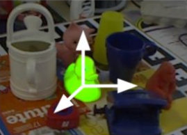
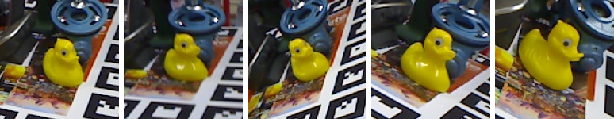

# Project proposal

**Project title: An AI Agent for Efficient Object Onboarding in Model-Free 6-DoF Pose Estimation**

## 1. The problem and goal

**The problem and goal in my project:**

An object's **6-dof pose** is its position (x, y, z) and orientation (roll, pitch, yaw) relative to the camera. A robot picking up a mug, for example, needs to know where the mug is and which way its handle points.

*Figure 1. 6-DoF pose estimation: the three arrows mark the duck's estimated position and orientation in the scene. Image: [BOP benchmark](https://bop.felk.cvut.cz/home/), Linemod (LM) dataset (Hinterstoisser et al., 2012).*

Our team's estimator is **model-free**: it needs no CAD model (digital 3D design) of the object. Instead, we **onboard** a new object from **reference images**, photos of it taken from different viewpoints, for example frames of a short video around it. The pipeline's **3D reconstructor** combines the references into a **point cloud**, a set of 3D points on the object's surface, which the estimator then uses to find the object's pose in new images. Onboarding usually yields far more references than needed: neighbouring frames are nearly identical, and some are blurry or repeat directions already covered. Every extra reference makes onboarding and pose estimation slower, but dropping the wrong ones leaves holes in the point cloud and costs accuracy. Choosing a minimal set by hand is slow and needs expertise.

*Figure 2. Five reference photos of the duck from different viewpoints. Several are nearly identical; from a pool of many such photos, the agent will keep only the ones it needs. Images: [BOP benchmark](https://bop.felk.cvut.cz/home/), Linemod (LM) dataset (Hinterstoisser et al., 2012).*

**Goal:** From a given pool of reference images, select a small subset whose point cloud is suitable for accurate pose estimation: it covers the parts of the object that will be seen, and every kept reference is well linked to the rest. The user confirms the final point cloud.

## 2. The simulator

**The simulator in my project:**

The ground used inside the agent's loop is the **3D reconstructor** in our in-house pose-estimation pipeline. Both the reconstructor and the downstream pose estimator stay fixed. The pipeline runs locally on a GPU, with a fixed seed for reproducibility. Each reconstruction takes seconds, making repeated experiments practical.

- **Inputs:** a text file listing the reference image paths and their camera parameters.
- **Outputs to the agent:** the point cloud and its connectivity: which references see each 3D point. A tool renders images of the coloured point cloud from a few fixed angles for the agent to inspect.

## 3. The agent's role

**The agent in my project:**

The agent runs a select, run, read, adjust loop:

1. Ask the user for the reference pool, camera information, how the object will be viewed, and time limits.
2. Select an initial subset, spread across viewing directions, and run the reconstructor.
3. Read the connectivity and look at the rendered images of the coloured point cloud next to the reference photos.
4. Decide whether the point cloud makes sense and, if not, change the subset. The agent checks that the shape matches the object, the colours match the photos, there is no background mixed in, no part appears twice, and nothing the application needs is missing. It then uses the connectivity to find which references cause each problem: drop a reference that adds only repeated points or causes a doubled or misplaced part, and add references where the point cloud is thin or has gaps. If it is unsure, it shows the user the images and asks.
5. Stop when the point cloud is judged good enough and no reference can be dropped without harming it, or when the budget runs out. Export the selected references and the point cloud, or report what is still missing.

*Figure 3. The agent's select, run, read, reason-and-adjust loop. Step 02 uses the fixed reconstructor and returns point-cloud outputs, not pose-estimation scores. After the user approves the final cloud, the fixed estimator measures accuracy on held-out images; these scores do not feed back into the agent. The point cloud and the links between references under step 03 are illustrative. Duck images: BOP benchmark, Linemod (LM) dataset.*

The agent changes only which references from the pool are included, from one reference up to the whole pool. The pipeline stays fixed. The reconstructor builds every point cloud and the agent only plans the next experiment.

A simple program could apply connectivity rules on its own, dropping references whose points are all seen by others, which is why the greedy selector is the baseline. It cannot tell whether the coloured point cloud makes sense: a misplaced reference can still share many points with the others while producing a doubled beak, and background points can be well connected yet clearly not part of the object. The language model should add value by spotting these problems in the images, tracing each one to the references responsible through the connectivity, and deciding when to ask the user.

**One question I still need to answer:** can the language model judge from images whether a coloured point cloud makes sense as reliably as the user, so that it needs to ask only in borderline cases?

## Explain your project to someone outside your field

**My project in simple words:**

A robot picking up a mug must know where the mug is and which way its handle points. Our software learns a new object from photos taken around it: it combines them into a rough 3D shape made of points, then finds the object in new camera pictures by comparing them with that shape. A short video gives hundreds of photos, many almost identical, and using all of them makes the software slow.

I will build an agent that picks the fewest photos needed. It builds the 3D shape from a few photos and checks which photos see which parts of it. It adds photos where the shape has gaps or where a photo is poorly connected to the others, and removes photos that only repeat what others already show. When it cannot tell whether the shape is good enough, it asks a person, who also approves the final result. The aim is a small set of photos that still gives a complete shape, makes the software faster, and makes adding new objects easier.
